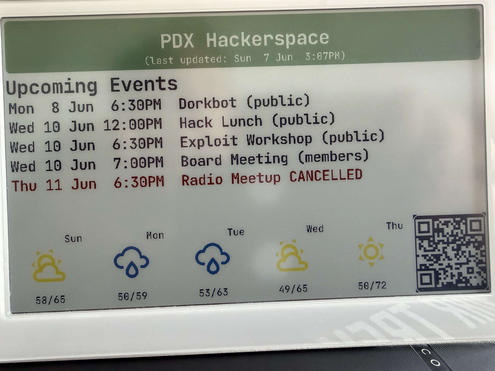
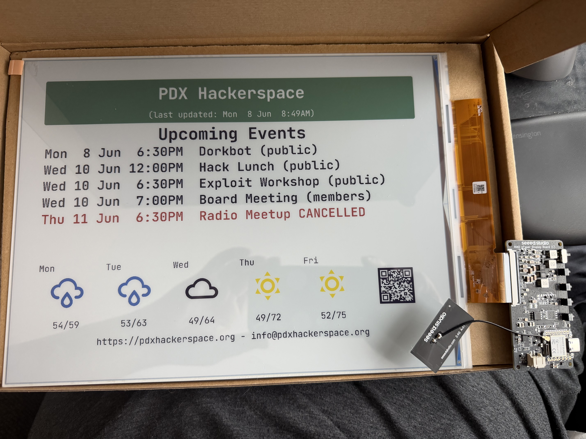

# E-ink Event Sign For PDX Hackerspace

[](https://github.com/romkey/pdxhackerspace-events-eink-sign/actions/workflows/ci.yaml)
[](https://github.com/romkey/pdxhackerspace-events-eink-sign/actions/workflows/lint.yaml)
[](https://esphome.io/)
[](LICENSE)

Since we now have an [event manager](https://github.com/pdxhackerspace/event-manager) at the hackerspace, I've been wanting to build a smart sign to hang in the doorway that would give a list of upcoming events. I got hung up on the idea of an e-ink sign because e-ink is pretty and looks sharp. It's also great for power savings, although the way I'm envisioning using this we'll keep it powered all the time, but it could be battery powered and just wake up and refresh once every 30 minutes or however long made sense. The sign shows the next five events, a five-day weather forecast from Home Assistant and a QR code for the events page, and only redraws the panel when something changed.

> **AI disclosure:** This project was written by AI under human oversight,
> following [these rules](https://github.com/romkey/esphome-ai-coding-rules/blob/main/RULES.md).

I wrote the initial firmware by hand and then put it down for a few months. When I came back to it I tried having Claude update it - Opus 4.8 did a great job and is apparently adept at writing ESPHome firmware now. It also made the changes to the 13.3" PR.

I'm sharing this in the spirit of sharing but I'm not intending to
generalize this or offer support to anyone trying to use it.

 

## What's here

| Path | What it is |
|------|------------|
| `packages/events.yaml` | Fetches events and the weather forecast, decides when the panel needs refreshing. No UI. |
| `packages/events-ui-800x480.yaml` | LVGL layout for 800x480 panels (7.3") |
| `packages/events-ui-1600x1200.yaml` | LVGL layout for 1200x1600 panels (13.3") rotated to landscape |
| `packages/battery.yaml` | LiPo battery voltage and approximate level |
| `components/epaper_spi/` | ESPHome's `epaper_spi` plus the 13.3" T133A01 controller and LVGL hardware rotation, for the EE02 |
| `examples/reterminal.yaml` | reTerminal E1002, 7.3" |
| `examples/reterminal-e1004.yaml` | reTerminal E1004, 13.3" |
| `examples/seeed-spectra6.yaml` | EE04 + 7.3" Spectra6 |
| `examples/seeed-spectra6-13.yaml` | EE02 + 13.3" Spectra6 |
| `examples/common/` | Settings shared by the examples: network, security, reTerminal hardware |
| `images/` | QR codes for the events page |
| `cases/` | OpenSCAD case for the 13.3" panel |
| `docs/configuration.md` | Every package option |

## Technical details

### Hardware

I have this running on four different platforms, all ESP32-S3:

- [SeeedStudio reTerminal E1002](https://www.seeedstudio.com/reTerminal-E1002-p-6533.html) with a 7.3" "Full-color" (6 color) ePaper display
- [SeeedStudio reTerminal E1004](https://www.seeedstudio.com/reTerminal-E1004-p-6692.html) with a 13.3" Spectra6 1200x1600 ePaper display
- [SeeedStudio EE04 controller](https://www.seeedstudio.com/XIAO-ePaper-Display-Board-EE04-p-6560.html) with [7.3" Spectra6 800x480 ePaper display](https://www.seeedstudio.com/7-3inch-Six-Color-eInk-ePaper-Display-with-800x480-Pixels-p-6567.html)
- [SeeedStudio EE02 controller](https://www.seeedstudio.com/XIAO-ePaper-DIY-Kit-EE02-for-13-3-Spectratm-6-E-Ink.html) with [13.3" Spectra6 1200x1600 ePaper display](https://www.seeedstudio.com/13-3inch-Six-Color-eInk-ePaper-Display-with-1200x1600-Pixels-p-6569.html)

It should be relatively easy to adapt this to other controllers; you'd need to change the pins used but the LVGL code should still work without modifications. The examples are all ESP32-S3 boards with specific panels, rather than the generic ESP32/C3/S3 set the rules call for, because the UI is tied to the panel resolution and needs PSRAM.

SeeedStudio is shipping a revised version of the EE04 - the original version had a defect that could damage panels and I may have run into that, not sure. I'm holding off on doing more work with the EE04 until I get the revised version.

I can **hear** the EE02 update the display. I think the inductors on the board are whining, and I can also hear a surprising soft *ker-chunk* on updates... so I'm going to check in with SeeedStudio to make sure this is expect and okay, because it's a bit alarming. (Yes, I've heard plenty of inductors whine in my life but I wasn't expecting that from this board).

| Device | Display | SPI CLK/MOSI | CS | DC | RST | BUSY | Buttons | LED | Battery ADC / enable |
|--------|---------|--------------|----|----|-----|------|---------|-----|----------------------|
| reTerminal E1002 | `7.3in-spectra-e6` | GPIO7 / GPIO9 | GPIO10 | GPIO11 | GPIO12 | GPIO13 | GPIO3, 4, 5 | GPIO6 | GPIO1 / GPIO21 |
| reTerminal E1004 | `Seeed-reTerminal-E1004` | GPIO7 / GPIO9 | (model default) | | | | GPIO3, 4, 5 | GPIO48 | GPIO1 / GPIO21 |
| EE04 | `7.3in-spectra-e6` | GPIO7 / GPIO9 | GPIO44 | GPIO10 | GPIO38 | GPIO4 | GPIO5, 2, 3 | GPIO6 | GPIO1 / GPIO21 |
| EE02 | `Seeed-ee02-color-13.3` | GPIO7 / GPIO9 | (model default) | | | | GPIO2, 3, 5 | | |

The reTerminals also have an SHT4x temperature/humidity sensor at I2C 0x44 (SDA GPIO19, SCL GPIO20) and a buzzer on GPIO45.

Datasheet: [13.3" Spectra6 module](datasheets/13.3_E6_eInk_Display_module_Datasheet.pdf).

### Firmware

All are running firmware built with [ESPHome](https://esphome.io) using LVGL. ESPHome has integrated support for the 7.3" ePaper display
and an [outstanding PR for the 13.3" display](https://github.com/esphome/esphome/pull/13860), which I had
to make a few changes to and will contribute back when I have time to review them. That's `components/epaper_spi/`, used by the EE02.

ESPHome 2026.7.0 added [native support for the reTerminal E1004's 13.3" display](https://github.com/esphome/esphome/pull/16706)
(`epaper_spi` model `Seeed-reTerminal-E1004`), so `reterminal-e1004.yaml` uses the stock component.

The weather comes from a Home Assistant sensor, `sensor.weather_forecast_5_day`, whose `forecast` attribute holds JSON like `{"f": [{"d":"Sun","c":"cloudy","h":65,"l":58}, ...]}`. HA 2024.3+ removed the weather entity's forecast attribute, so this is a template sensor that calls `weather.get_forecasts`.

### Case

The OpenSCAD case is a work in progress and should be ignored for now. Looking for good framing/case solutions. The
Spectra6 display is fragile and needs mechanical protection.

## Building and using

Requires Docker.

```bash
cp examples/secrets.yaml.example examples/secrets.yaml   # then edit it
docker compose run --rm validate     # check every example
docker compose run --rm build        # compile every example
docker compose run --rm lint         # all lint checks, like CI
```

The first build downloads the toolchains into a Docker volume; later builds reuse them and only recompile what changed.

Build, upload or follow the logs of one device:

```bash
docker compose run --rm esphome compile examples/reterminal-e1004.yaml
docker compose run --rm esphome upload examples/reterminal-e1004.yaml
docker compose run --rm esphome logs examples/reterminal-e1004.yaml
```

Or use the dashboard at http://localhost:6052:

```bash
docker compose up dashboard
```

Put settings for your own devices (a static address, a different network) in `examples/local-<name>.yaml`, which git ignores:

```yaml
packages:
  device: !include reterminal-e1004.yaml

wifi:
  use_address: 192.168.1.50
```

USB serial flashing from Docker works on Linux only. On macOS, flash the first time with https://web.esphome.io and use OTA after that.

To use the packages in your own config, pin them to a release:

```yaml
packages:
  events: github://romkey/pdxhackerspace-events-eink-sign/packages/events.yaml@v0.1.0
  events_ui: github://romkey/pdxhackerspace-events-eink-sign/packages/events-ui-800x480.yaml@v0.1.0
```

See [docs/configuration.md](docs/configuration.md) for every option.

## License

My code is offered under the [MIT License](LICENSE). The ESPHome PR in `components/epaper_spi/` should be considered to be under [ESPHome's License](https://github.com/esphome/esphome/blob/dev/LICENSE).

The manufacturer datasheets in [datasheets/](datasheets/) belong to their manufacturers and are not covered by this license; see each datasheet's `-license.txt`.
